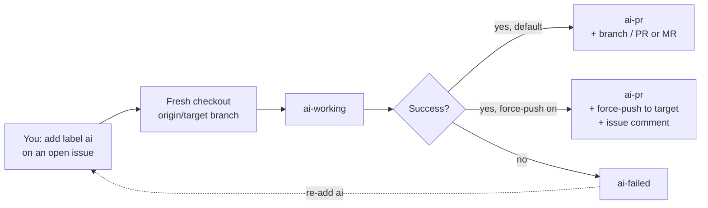
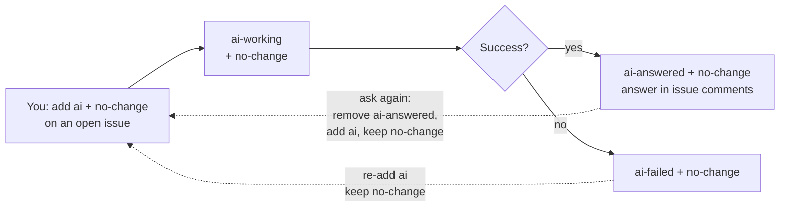
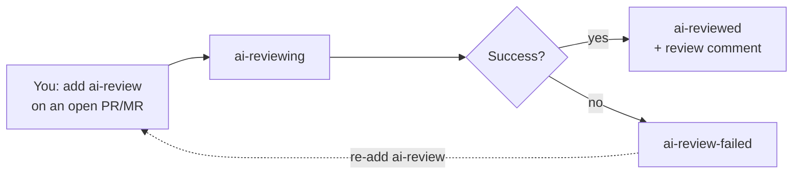
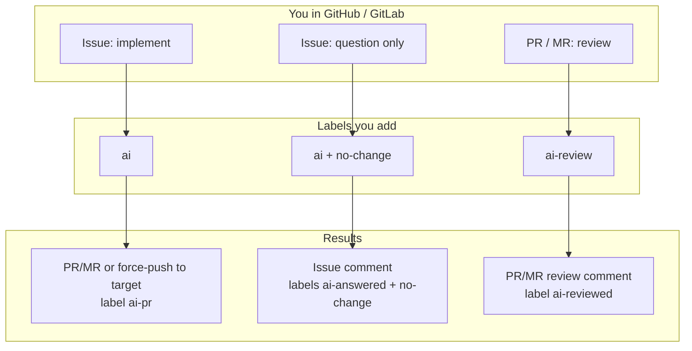

# AI Worker

Self-hosted AI agent platform for **GitHub** and **GitLab**. Label an issue or merge request, and AI Worker runs coding agents (Cursor CLI / Claude Code / Codex CLI / Gemini CLI / GitHub Copilot CLI) in your environment to implement work or review changes.

AI Worker is designed for teams that want automation **on their own infrastructure**—including companies running **GitLab Self-Managed**—without sending repositories to a third-party hosted agent service.

**You do not need to clone this repository** for a standard deployment. Install Docker first, then run the quick-start command below. The app image is pulled from Docker Hub.

| | |
|---|---|
| Docs | [vibeplus1.com/ai-worker](http://vibeplus1.com/ai-worker) |
| Image | [`sami1367/ai-worker`](https://hub.docker.com/r/sami1367/ai-worker) |
| Source | [github.com/sami1367/ai-worker](https://github.com/sami1367/ai-worker) |
| License | [Apache-2.0](LICENSE) (see [third-party notices](THIRD_PARTY_NOTICES.md) and [license audit](docs/LICENSE_AUDIT.md)) |

---

## Self-hosted on your infrastructure

AI Worker is **fully self-hosted**. You install and run it on hardware you control—your laptop, a workstation, or a dedicated server. Your repositories, credentials, and agent runs stay on your side of the firewall. There is no mandatory third-party hosted agent cloud.

You *can* run it on a personal computer. For the **best day-to-day experience**, we recommend a small always-on server (VPS or private cloud). The worker stays online around the clock, so you can label issues or merge requests from your phone—or any device—and automation continues even when your laptop is closed, asleep, or powered off. Your computer becomes optional; your AI workflow does not.

---

## Commercial Services

For organizations that want help deploying or operating a self-hosted setup—especially those using **GitLab Self-Managed**—paid professional services are available on request:

- **Installation and deployment** — production-oriented Docker Compose setup, networking, and operational handoff
- **Security hardening** — secret handling, access controls, and alignment with your environment’s security practices
- **GitLab Self-Managed integration** — webhooks, tokens, labels, and workflow fit for internal GitLab
- **AI workflow and prompt customization** — adapt implement/review behavior to your engineering standards
- **Optional maintenance and technical support** — ongoing help after go-live, by agreement

Services are scoped per engagement. Contact details are below; no public price list is published here.

---

## Contact

| Channel | |
|---------|--|
| GitHub | [github.com/sami1367/ai-worker](https://github.com/sami1367/ai-worker) · [github.com/sami1367](https://github.com/sami1367) |
| Business email | [sjd.rhm@gmail.com](mailto:sjd.rhm@gmail.com) |
| Website | [vibeplus1.com](https://vibeplus1.com/) |
| LinkedIn | [linkedin.com/in/sami-rahimi](https://www.linkedin.com/in/sami-rahimi/) |

---

## Install requirements (before you start the service)

Complete this **before** [Quick start](#quick-start). Quick start does **not** install Docker.

You need: **Docker Engine**, **Docker Compose v2** (`docker compose`), `curl`, `bash`, outbound network, ~2 GB RAM.

### Linux (Ubuntu / Debian / most VPS) — one paste

Official convenience script ([get.docker.com](https://get.docker.com)) installs Engine + Compose, then starts the daemon:

```bash
curl -fsSL https://get.docker.com | sudo sh && \
sudo systemctl enable --now docker && \
sudo usermod -aG docker "$USER" && \
sudo docker --version && sudo docker compose version
```

Log out and back in (or reboot) so `docker` works without `sudo`. Until then use `sudo docker …`.

**If that fails**, Ubuntu/Debian packages (also one paste):

```bash
sudo apt-get update && \
sudo apt-get install -y docker.io docker-compose-v2 && \
sudo systemctl enable --now docker && \
sudo usermod -aG docker "$USER" && \
sudo docker --version && sudo docker compose version
```

### Other platforms

| Platform | Install |
|----------|---------|
| macOS / Windows | [Docker Desktop](https://docs.docker.com/desktop/) (includes Compose) — one installer |
| Manual Engine docs | [Docker Engine install](https://docs.docker.com/engine/install/) |

Confirm `docker` and `docker compose` print versions before Quick start. More: [docs/DEPLOYMENT.md](docs/DEPLOYMENT.md).

---

## Quick start

Run this only after [Install requirements](#install-requirements-before-you-start-the-service) pass. One command — creates the folder, downloads Compose + `.env`, **auto-generates secure secrets**, and starts the stack:

```bash
mkdir -p ai-worker && cd ai-worker && \
curl -fsSL -o docker-compose.yml \
  https://raw.githubusercontent.com/sami1367/ai-worker/main/docker-compose.yml && \
curl -fsSL -o .env \
  https://raw.githubusercontent.com/sami1367/ai-worker/main/.env.example && \
curl -fsSL https://raw.githubusercontent.com/sami1367/ai-worker/main/scripts/generate-env.sh | bash && \
docker compose up -d && \
curl -fsS http://127.0.0.1:8080/api/v1/health && \
echo && echo "INITIAL_ADMIN_BOOTSTRAP_SECRET=$(cat INITIAL_ADMIN_BOOTSTRAP_SECRET.txt)" && \
echo "Open http://127.0.0.1:8080/setup and paste that secret."
```

You do **not** fill secrets by hand. After the command finishes, the bootstrap secret is printed again and saved in:

- `INITIAL_ADMIN_BOOTSTRAP_SECRET.txt` — `cat INITIAL_ADMIN_BOOTSTRAP_SECRET.txt`
- `.env` — `grep INITIAL_ADMIN_BOOTSTRAP_SECRET .env`

## Create admin

1. Open http://127.0.0.1:8080/setup  
2. Paste `INITIAL_ADMIN_BOOTSTRAP_SECRET` (`cat INITIAL_ADMIN_BOOTSTRAP_SECRET.txt`)  
3. Enter an **admin email** (used for CodeGraph Pro waitlist signup when the worker configures CodeGraph)  
4. Choose admin username + password (min 12 characters)

Optional forge / AI tokens can be added to `.env` anytime, or set later in the UI (see [AI providers](#ai-providers)). Restart after editing `.env`:

```bash
docker compose up -d
```

### Access the Web UI from your local computer

If AI Worker runs on a remote server, the UI listens on that machine’s `127.0.0.1:8080` and is not exposed to the public internet. Use an **SSH tunnel** so your laptop’s browser can reach it securely:

```bash
ssh -N -L 8080:127.0.0.1:8080 user@SERVER_IP
```

Replace `user` with your SSH username and `SERVER_IP` with the server’s hostname or IP.

What this does:

- `-L 8080:127.0.0.1:8080` — forwards your local port `8080` to the server’s `127.0.0.1:8080` (where AI Worker listens)
- `-N` — opens the tunnel only (no remote shell)

Keep that terminal open. On your computer, open http://127.0.0.1:8080 (or http://127.0.0.1:8080/setup for first-time admin setup).

### Removing `.env` after setup

On first successful start, required secrets are saved on the Docker `data` volume at `/data/config/app-secrets.env`. You may delete the host `.env` afterward if you do not need optional env overrides. Keep an offline backup of encryption/session secrets — see [docs/BACKUP_RESTORE.md](docs/BACKUP_RESTORE.md).

---

## AI providers

AI Worker ships five coding agents in the Docker image. Connect at least one under **Providers** (http://127.0.0.1:8080/providers): enable it, paste credentials, and set a default. Secrets are encrypted at rest and never shown again after save. You can also put the same variables in compose `.env` (DB/UI values override env when both are set).

| Provider | Credential | Env vars |
|----------|------------|----------|
| **Cursor CLI** | Cursor API key | `CURSOR_API_KEY` |
| **Claude Code** | Anthropic API key or Claude Code OAuth token | `ANTHROPIC_API_KEY` or `CLAUDE_CODE_OAUTH_TOKEN` |
| **Codex CLI** | OpenAI API key | `OPENAI_API_KEY` or `CODEX_API_KEY` |
| **Gemini CLI** | Gemini API key | `GEMINI_API_KEY` |
| **GitHub Copilot CLI** | Fine-grained GitHub PAT with **Copilot Requests** | `COPILOT_GITHUB_TOKEN` |

Notes:

- Copilot requires a **fine-grained** PAT with the Copilot Requests permission. Classic `ghp_` tokens are not supported. Use `COPILOT_GITHUB_TOKEN` — do not reuse forge `GITHUB_TOKEN` / `GH_TOKEN` for the agent.
- Per-repository you can override the default provider on the repository page.
- Use **Test** on the Providers page to confirm the CLI binary and credential wiring.

---

## CodeGraph

[CodeGraph](https://github.com/colbymchenry/codegraph) builds a local semantic index (`.codegraph/`) in each workspace and wires MCP into the agent CLIs so agents can navigate code more accurately.

- Installed in the image and enabled **per repository by default** (toggle on the repository page).
- When enabled, the worker runs `codegraph init` before an agent if `.codegraph/` is missing.
- When disabled, `.codegraph/` is removed and not recreated until you turn the option back on.
- The index is **never committed** (unstaged / gitignored from agent publishes).
- At first-admin setup, the admin email is exported for optional CodeGraph Pro waitlist signup on worker start.

---

## Connect GitHub or GitLab

After admin setup, open **Connections** at http://127.0.0.1:8080/connections.

Use a **personal access token** for API access (issues, MRs, labels, comments).  
**Git clone/push** uses that same token over HTTPS when the forge allows it. A platform SSH key is **optional** (see below).

### GitHub token

1. Open [GitHub → Settings → Developer settings → Personal access tokens](https://github.com/settings/tokens)  
   - Classic: [https://github.com/settings/tokens](https://github.com/settings/tokens) → **Generate new token (classic)**  
   - Fine-grained: [https://github.com/settings/personal-access-tokens](https://github.com/settings/personal-access-tokens) → **Generate new token**
2. In AI Worker → **Connections** → **Connect GitHub**, paste the token.

**Classic PAT — required scopes**

| Scope | Why |
|-------|-----|
| `repo` | Full private/public repo access (clone via HTTPS, issues, PRs, contents). Prefer this over `public_repo` alone. |
| `workflow` | Optional; only if agents must edit GitHub Actions workflows |

**Fine-grained PAT — required permissions**

| Permission | Access |
|------------|--------|
| Repository access | Select the repos AI Worker will use (or all) |
| **Metadata** | Read-only |
| **Contents** | Read and write |
| **Issues** | Read and write |
| **Pull requests** | Read and write |
| **Workflows** | Read and write (optional; same as classic `workflow`) |

For **organization private repos**, create the fine-grained token with that **organization as the resource owner**, and ensure the org allows fine-grained PATs.

### GitLab token

Works with **gitlab.com** and **self-managed** (e.g. `https://git.example.com`).

1. Open your GitLab → **Preferences → Access Tokens**  
   - gitlab.com: [https://gitlab.com/-/user_settings/personal_access_tokens](https://gitlab.com/-/user_settings/personal_access_tokens)  
   - Self-managed: `https://<your-gitlab-host>/-/user_settings/personal_access_tokens`
2. Create a token and in AI Worker → **Connections** → **Connect GitLab**, set the **server URL** (e.g. `https://gitlab.com` or `https://git.example.com`) and paste the token.

**Required scopes**

| Scope | Why |
|-------|-----|
| `api` | **Recommended.** API + repository access for issues, MRs, labels, comments, and HTTPS git when enabled |
| `read_api` | Minimum to *list* private projects only — not enough for full worker ops; use `api` |

### HTTPS git clone (token only) vs optional SSH

AI Worker clones with **HTTPS + your token by default**. That works when the forge allows git over HTTP(S).

**GitLab self-managed:** if clone fails with `Git access over HTTP is not allowed`, an admin can enable HTTPS git (no SSH required):

1. GitLab **Admin** → **Settings** → **General** → **Visibility and access controls**
2. **Enabled Git access protocols** → set to **Both** or **HTTP** (not “Only SSH”)
3. Save, then in AI Worker open the repository → **Retry clone**

(“HTTP” here means git over **HTTPS** to your `https://…` GitLab URL — not plain `http://`.)

**Platform SSH key (optional):** on first start AI Worker generates one shared key on the data volume. The **public** key is shown on **Connections**; the private key never leaves the volume. Add it only if you keep GitLab on **Only SSH**, or prefer SSH for git:

- GitLab: [Preferences → SSH Keys](https://gitlab.com/-/user_settings/ssh_keys) (self-managed: `https://<host>/-/user_settings/ssh_keys`)
- GitHub: [Settings → SSH and GPG keys](https://github.com/settings/keys)

If HTTPS git is enabled, you can ignore the SSH key and use the token alone for clone and push.

---

## How to use AI Worker in GitHub / GitLab

After you connect a forge and repositories appear under **Repositories**, work is driven entirely by **issue and PR/MR labels** in GitHub or GitLab. You do not need to open a terminal on the AI Worker host for day-to-day tasks.

### One-time project setup

1. Connect GitHub or GitLab under **Connections** (token steps above).
2. Wait for discovery (or click **Fetch repos**) so projects appear.
3. Enable the repositories you want automated.
4. Optional: **Setup labels** / **Setup webhooks** on the connection or repository page.
5. Labels are also created automatically when a project is registered and again whenever the worker is about to change labels on that project — so older repos pick up new labels (for example `no-change`) without a manual setup run.

### Repository options (per repo)

Open a repository in the panel to configure how implement jobs publish changes:

| Setting | Default | What it does |
|---------|---------|--------------|
| **PR / MR target branch** | Forge default (often `main`) | Branch that new pull/merge requests target. Also used as the clean checkout base before each run. |
| **Force-push to target branch (skip PR/MR)** | Off | When **enabled**, issue implement force-pushes commits onto the target branch instead of opening a PR/MR, and posts a result comment on the issue. Overwrites that remote branch — use with care. |
| **Block new issues while an AI-labeled PR/MR is open** | On | Prevents starting another implement job while an AI-labeled PR/MR is still open (ignored when force-push mode skips PRs/MRs). |
| **Enable CodeGraph** | On | Keeps a local `.codegraph/` semantic index and runs `codegraph init` before agents when missing. Turn off to remove the index for that repo. |
| **AI provider** | Global default | Optional per-repo override of which agent CLI runs (Cursor / Claude / Codex / Gemini / Copilot). |

Before every implement (and related) run, the worker **fetches a fresh copy of the target branch**, hard-resets to `origin/<target>`, and discards uncommitted workspace changes so each job starts clean.

### What you do in the forge

| Goal | Where | Labels to add | What happens |
|------|--------|---------------|--------------|
| Implement a change | Open **issue** | `ai` | Agent implements from a fresh target-branch checkout, then opens a PR/MR **or** force-pushes to the target branch (if that repo option is enabled) |
| Ask a question about the code | Open **issue** | `ai` + `no-change` | Agent answers in an **issue comment** only (no branch, no PR/MR) |
| Review a change | Open **PR** (GitHub) or **MR** (GitLab) | `ai-review` | Agent posts a review comment on the PR/MR |

Tips:

- Write a clear title and description (and comments). Newer comments override older ones when they conflict.
- Keep the issue/PR **open** while the worker runs.
- To **retry** after failure: fix the problem if needed, then add `ai` or `ai-review` again (keep `no-change` if you are in Q&A mode).
- To **ask again** after `ai-answered`: keep `no-change`, remove `ai-answered`, add `ai` again.
- Set the **target branch** (for example `main`, `master`, or `develop`) on the repository page before relying on implement jobs.

---

## Label reference

These labels are managed by AI Worker on each connected repository:

| Label | Color idea | Meaning | Who adds it |
|-------|------------|---------|-------------|
| `ai` | Green | Queue implement or (with `no-change`) Q&A | **You** |
| `no-change` | Teal | With `ai`: answer only, no code / no PR | **You** (keep it on the issue) |
| `ai-working` | Yellow | Worker is processing the issue/PR | Worker |
| `ai-pr` | Blue | Implement finished; PR/MR created (or updated). With force-push mode, changes landed on the target branch instead | Worker |
| `ai-answered` | Green | Q&A finished; answer posted as a comment | Worker |
| `ai-failed` | Red | Implement / Q&A failed — check worker logs | Worker |
| `ai-review` | Purple | Queue an AI review on an open PR/MR | **You** |
| `ai-reviewing` | Yellow | Worker is writing the review | Worker |
| `ai-reviewed` | Green | Review comment posted | Worker |
| `ai-review-failed` | Red | Review failed — check logs | Worker |

You normally only add **`ai`**, **`ai` + `no-change`**, or **`ai-review`**. The worker moves the status labels through the lifecycle below.

---

## Label lifecycles

### 1. Implement an issue (`ai` → PR/MR or force-push)

Use this when you want code changes. By default the worker opens a pull/merge request against the repository’s **target branch**. If **Force-push to target branch** is enabled for that repo, it force-pushes onto the target branch instead (no PR/MR).



**Steps**

1. Confirm the repository **target branch** (and optional force-push setting) on the repository page.
2. Open an issue describing the work.
3. Add label `ai`.
4. Watch labels: `ai` → `ai-working` → `ai-pr` (or `ai-failed`).
5. Review the PR/MR, **or** review the commits on the target branch if force-push mode is on.

### 2. Ask a question — no code changes (`ai` + `no-change`)

Use this when you only need an answer about the repository (design, “where is X?”, how something works). No branch and no PR/MR.



**Steps**

1. Open an issue with your question.
2. Add **`ai`** and **`no-change`**.
3. Wait for the AI comment on the issue.
4. Final labels: **`ai-answered`** + **`no-change`**.

### 3. Review a pull / merge request (`ai-review`)

Use this on an **already open** PR (GitHub) or MR (GitLab).



**Steps**

1. Open or push to a PR/MR.
2. Add label `ai-review`.
3. Wait for the review comment.
4. Final label: `ai-reviewed` (or `ai-review-failed`).

### 4. Overview of all workflows



---

## Everyday commands (host)

Update later:

```bash
docker compose pull
docker compose up -d
```

Stop:

```bash
docker compose down
```

---

## Troubleshooting

| Problem | Fix |
|---------|-----|
| `docker: command not found` or `docker compose: command not found` | Run the one-paste install under [Install requirements](#install-requirements-before-you-start-the-service). Quick start does not install Docker. |
| `get.docker.com` / Docker CE install fails | Use the Ubuntu/Debian fallback paste in Install requirements (`docker.io` + `docker-compose-v2`). |
| `curl` 404 on GitHub raw URL | Repo must be **public** (Settings → Danger Zone → Change visibility) |
| Cannot pull image | Is `sami1367/ai-worker:latest` on Hub? Try `docker pull sami1367/ai-worker:latest` |
| Secrets missing / insecure | Re-run: `curl -fsSL https://raw.githubusercontent.com/sami1367/ai-worker/main/scripts/generate-env.sh \| bash` |
| `migrate` fails / CREATE SCHEMA | Password mismatch or old DB volume: see [docs/SECURITY.md](docs/SECURITY.md#migrating-from-older-compose-defaults) |
| Wrong bootstrap secret | Use the value printed by `generate-env.sh` / in `.env` (not a placeholder) |
| `Git access over HTTP is not allowed` | GitLab admin: enable **Both** or **HTTP** git protocols (see above), then Retry clone — or add the optional platform SSH public key from Connections |
| Clone works after enabling HTTPS git | Expected — token-only path; SSH not required |

---

## License and notices

- Project source: [Apache License 2.0](LICENSE)
- Copyright and notice: [NOTICE](NOTICE)
- Third-party and proprietary CLI terms: [THIRD_PARTY_NOTICES.md](THIRD_PARTY_NOTICES.md)
- Audit findings and unresolved vendor questions: [docs/LICENSE_AUDIT.md](docs/LICENSE_AUDIT.md)

Cursor Agent CLI, Claude Code, Codex CLI, and GitHub Copilot CLI are proprietary products of their vendors; Gemini CLI is Apache-2.0 with API use under Google’s terms; CodeGraph CLI is MIT. AI Worker does not relicense them. Operators must use their own provider credentials and comply with Cursor, Anthropic, OpenAI, Google, and GitHub terms.

---

## Developers

Building, publishing, and local Node setup: [README.DEVELOPMENT.md](README.DEVELOPMENT.md)

Security and secret rotation: [docs/SECURITY.md](docs/SECURITY.md)
