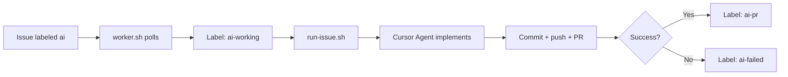

# AI Worker

A server-side automation service that watches GitHub issues across multiple repositories, runs the Cursor Agent to implement them, and opens pull requests for human review.

Label an issue with `ai` and the worker picks it up, implements the change in an isolated branch, commits, pushes, and creates a PR. It never merges automatically.

## How it works



1. **`worker.sh`** polls every 60 seconds, reading registered projects from `projects.conf`.
2. For each project, it finds the oldest open issue with the `ai` label.
3. The label is changed to `ai-working` so the issue is not picked up again.
4. **`run-issue.sh`** runs the full pipeline for that issue:
   - Ensures the repo is clean and `main` is up to date
   - Creates a branch (`ai/issue-N` or `ai/issue-N-timestamp` if the branch already exists)
   - Builds a prompt from the issue title and body
   - Runs the Cursor Agent (`agent` or `cursor-agent`) in the project workspace
   - Stages changes, blocks commits that include secrets, commits, pushes, and opens a PR
   - Cleans up: returns the local repo to `main` and removes the local task branch
5. On success, the issue label becomes `ai-pr`. On failure, it becomes `ai-failed` (not automatically re-queued).

## Prerequisites

| Requirement | Notes |
|-------------|-------|
| **Git** | Repos must use `main` as the default branch |
| **GitHub CLI** (`gh`) | Authenticated with access to the target repos |
| **jq** | JSON parsing for issue metadata |
| **flock** | Prevents multiple worker processes |
| **Cursor CLI** | `agent` or `cursor-agent` on `PATH` |

```bash
gh auth login
```

## Quick start

### 1. Register projects

Edit `projects.conf` — one project name and local path per line:

```conf
insta2site-api=/home/ubuntu/dev/insta2site-api
insta2site-laravel=/home/ubuntu/dev/insta2site-laravel
insta2site-ui=/home/ubuntu/dev/insta2site-ui
```

Each path must be a Git repository whose `origin` remote points to GitHub (`gh repo view` is used to resolve the repo).

### 2. Create GitHub labels

```bash
./setup-labels.sh
```

This creates four labels in every registered repository:

| Label | Color | Meaning |
|-------|-------|---------|
| `ai` | Green | Queue this issue for the worker |
| `ai-working` | Yellow | Worker is processing this issue |
| `ai-pr` | Blue | Worker finished and opened a PR |
| `ai-failed` | Red | Worker failed — review logs before retrying |

### 3. Start the worker

```bash
./worker.sh
```

The worker logs to `logs/worker.log` and uses `state/worker.lock` to ensure only one instance runs.

### 4. Queue work

Add the `ai` label to any open GitHub issue in a registered repository.

## Manual run (single issue)

To run one issue without the polling loop:

```bash
./run-issue.sh <project> <issue-number>
```

Example:

```bash
./run-issue.sh insta2site-api 1
```

## Label lifecycle

```
ai  →  ai-working  →  ai-pr      (success)
                 ↘  ai-failed   (failure)
```

- **Success:** `ai` is removed, `ai-working` is removed, `ai-pr` is added.
- **Failure:** `ai` is removed, `ai-working` is removed, `ai-failed` is added.
- **Retry:** After reviewing logs, manually add the `ai` label again. The worker removes `ai-failed` when it picks up the issue.

Failed issues are **not** automatically re-queued, which avoids infinite retry loops.

## What Cursor does vs. what the scripts do

The Cursor Agent is instructed to implement the issue, run tests, and leave **uncommitted** changes in the working tree. It must **not** run Git or GitHub commands.

`run-issue.sh` handles everything after the agent finishes:

- `git add`, `git commit`, `git push`
- Pull request creation via `gh pr create`
- Branch cleanup and checkout back to `main`

## Safety

- **Clean repo required** — Tasks refuse to start if the working tree is dirty.
- **Secret blocking** — Staged files matching `.env`, `*.pem`, `*.key`, `id_rsa`, or `id_ed25519` cause the run to abort before commit.
- **No auto-merge** — PRs are always opened for human review.
- **Single worker** — File lock prevents concurrent worker processes.
- **Single issue per cycle** — Only one issue is processed per polling interval.
- **Cleanup on exit** — Local task branches are deleted and `main` is restored even after failures.

## Directory layout

```
ai-worker/
├── worker.sh          # Main polling loop
├── run-issue.sh       # Full pipeline for one issue
├── setup-labels.sh    # Create labels in all registered repos
├── projects.conf      # Project name → local path mapping
├── logs/              # Per-run logs (gitignored)
│   ├── worker.log
│   └── <project>-issue-<n>-<timestamp>.*
└── state/             # Runtime state (gitignored)
    ├── worker.lock
    └── <project>-issue-<n>.*
```

### Log files per run

| File | Contents |
|------|----------|
| `*.log` | Main script output |
| `*.prompt.txt` | Prompt sent to Cursor |
| `*.cursor.ndjson` | Cursor Agent stream output |
| `*.cursor.stderr.log` | Cursor stderr |
| `*.result.txt` | Success summary (branch, commit, PR URL) |
| `*-pr.md` | Pull request body used for `gh pr create` |

## Configuration

| Setting | Location | Default |
|---------|----------|---------|
| Poll interval | `worker.sh` → `CHECK_INTERVAL` | 60 seconds |
| Base directory | Scripts → `BASE_DIR` | `/home/ubuntu/ai-worker` |
| Branch naming | `run-issue.sh` | `ai/issue-<number>` |

## Troubleshooting

| Problem | What to check |
|---------|----------------|
| Issue not picked up | Open issue? Has `ai` label? Repo in `projects.conf`? |
| `ai-failed` on issue | `logs/<project>-issue-<n>-*.log` and `*.cursor.ndjson` |
| Worker not starting | Another instance may be running (`state/worker.lock`) |
| Cursor CLI missing | Install Cursor CLI; ensure `agent` or `cursor-agent` is on `PATH` |
| PR not created | Check `gh` auth and repo permissions in the main log |

## License

Private infrastructure — adjust as needed for your organization.
