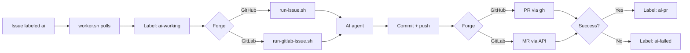

# AI Worker

Server-side automation that watches **GitHub** and **GitLab** issues, runs an AI agent to implement them, and opens pull/merge requests for human review. On GitLab it can also **AI-review merge requests** when you add a label.

Supported AI backends: **Cursor** (default) and **Claude Code**. Switch with one setting in `.env` — see [AI providers](#ai-providers).

Label an issue with `ai` → worker implements it on a branch → opens a PR (GitHub) or MR (GitLab). Label a GitHub PR or GitLab MR with `ai-review` → worker reviews the diff (and linked issues) and posts a review comment. It never merges automatically.

---

## How to run this app

### One-time setup

```bash
cd /home/ubuntu/ai-worker

# 1) GitHub auth (skip if you only use GitLab)
gh auth login

# 2) GitLab auth (skip if you only use GitHub)
cp .env.example .env
nano .env
# Set:
#   GITLAB_HOST=git.dctm.dev
#   GITLAB_TOKEN=<personal access token with api scope>

# 3) Register local clones (see sections below)
cp -n projects.conf.example projects.conf
cp -n gitlab-projects.conf.example gitlab-projects.conf
nano projects.conf
nano gitlab-projects.conf

# 4) Choose AI provider (see "AI providers" section below)
#    Default is Cursor. To use Claude Code, set AI_PROVIDER=claude in .env

# 5) Create issue + MR-review labels on all registered repos
./setup-labels.sh
```

### Run in the foreground (manual / debug)

```bash
cd /home/ubuntu/ai-worker
./worker.sh
```

- Logs: `logs/worker.log`
- Lock: `state/worker.lock` (only one worker at a time)
- Stop: `Ctrl+C`

### Run a single issue or PR/MR review (without the poll loop)

```bash
# GitHub issue
./run-issue.sh <project-name> <issue-number>

# GitHub PR AI review
./run-github-pr-review.sh <project-name> <pull-request-number>

# GitLab issue
./run-gitlab-issue.sh <project-name> <issue-iid>

# GitLab MR AI review
./run-gitlab-mr-review.sh <project-name> <merge-request-iid>
```

Examples:

```bash
./run-issue.sh insta2site-api 1
./run-github-pr-review.sh insta2site-api 42
./run-gitlab-issue.sh bale-service 12
./run-gitlab-mr-review.sh bale-service 34
```

### Queue work (automatic mode)

With the worker running as a systemd service (recommended), you only touch GitLab/GitHub labels — no manual scripts.

| What you want | Where | What you do | What the worker does |
|---------------|-------|-------------|----------------------|
| Implement an issue | GitHub or GitLab project listed in conf | Add label **`ai`** on an open issue | Implements → opens PR/MR → `ai-pr` / `ai-failed`. **Waits** if that same repo already has an open AI PR/MR. |
| Create next draft/upcoming release | GitHub (`projects.conf`) or GitLab (`gitlab-projects.conf`) | Open an issue titled **`new release`** or **`new tag`**, add label **`ai`** | Skips AI → fetch/pull + tags → bumps past highest `vMAJOR.MINOR.PATCH` from git tags **or** forge releases (GitHub drafts / GitLab upcoming) → **pushes a real git tag** (so tag-based Actions CI runs) → creates draft (GitHub) or upcoming (GitLab) release → comments + closes the issue → `ai-pr` / `ai-failed` |
| AI-review a PR | GitHub project in `projects.conf` | Add label **`ai-review`** on an open PR | Reviews diff + linked issues → posts PR comment → `ai-reviewed` / `ai-review-failed` |
| AI-review an MR | GitLab project in `gitlab-projects.conf` | Add label **`ai-review`** on an open MR | Reviews diff + linked issues → posts MR comment → `ai-reviewed` / `ai-review-failed` |

**PR/MR review automation (end-to-end):**

1. List each project once in [`projects.conf`](projects.conf.example) (GitHub) and/or [`gitlab-projects.conf`](gitlab-projects.conf.example) (GitLab).
2. Ensure labels exist (`./setup-labels.sh`) and, for GitLab, `.env` has `GITLAB_TOKEN`.
3. Keep `ai-worker` running under systemd.
4. On any open PR/MR in those projects, add **`ai-review`**.
5. Within ~60s the worker claims it (`ai-reviewing`), runs the review, posts a comment, then sets `ai-reviewed`.

It polls every ~60s when idle. It never runs two jobs at once. **New issues** in a repo wait if that same repo already has an open AI pull/merge request (branch `ai/issue-*`) or an issue labeled `ai-working`. An open PR/MR in another repo does not block this one. After that PR/MR is merged or closed, the next `ai` issue in that repo is picked up. Labeling an existing PR/MR with `ai` or `ai-review` is not blocked.

**Review queue example:** label three open PRs/MRs with `ai-review` → worker reviews the oldest first → updates labels → immediately picks the next → and so on.

Idle log line (healthy):

```text
[YYYY-MM-DD HH:MM:SS UTC] No queued AI issues or PR/MR reviews. Sleeping 60s.
```

When a previous AI PR/MR is still open **in that same repo**:

```text
[YYYY-MM-DD HH:MM:SS UTC] Not starting a new issue in this repo (github my-app: open pull request #12 (ai/issue-3)).
[YYYY-MM-DD HH:MM:SS UTC] No queued AI issues or PR/MR reviews. Sleeping 60s.
```

---

## Add as a Linux systemd service

Use this so the worker starts on boot, keeps polling forever, and restarts after failures. Follow the same steps when you **move to a new server**.

### 0. On a new server — prerequisites first

Do this **before** installing the unit (paths assume user `ubuntu` and install dir `/home/ubuntu/ai-worker`):

```bash
# Clone this repo
sudo -u ubuntu git clone <THIS-REPO-URL> /home/ubuntu/ai-worker
cd /home/ubuntu/ai-worker

# Cursor CLI must be on PATH for user ubuntu (agent / cursor-agent)
# typically installed under ~/.local/bin or ~/.cursor/bin

# GitHub (optional)
sudo -u ubuntu gh auth login

# GitLab
sudo -u ubuntu cp .env.example .env
sudo -u ubuntu nano .env   # GITLAB_HOST + GITLAB_TOKEN

# Register clones
sudo -u ubuntu cp -n projects.conf.example projects.conf
sudo -u ubuntu cp -n gitlab-projects.conf.example gitlab-projects.conf
sudo -u ubuntu nano projects.conf
sudo -u ubuntu nano gitlab-projects.conf

# Create labels on all registered repos
sudo -u ubuntu ./setup-labels.sh
```

If your username or install path differs, edit `User` / `Group` / `WorkingDirectory` / `ExecStart` / `HOME` / `PATH` in the unit file below.

### 1. Install the unit file

Repo unit: [`ai-worker.service`](ai-worker.service).

```bash
sudo cp /home/ubuntu/ai-worker/ai-worker.service /etc/systemd/system/ai-worker.service
sudo systemctl daemon-reload
sudo systemctl enable ai-worker
sudo systemctl start ai-worker
```

Or create/edit the unit by hand:

```bash
sudo nano /etc/systemd/system/ai-worker.service
# paste the unit contents from the section below, then:
sudo systemctl daemon-reload
sudo systemctl enable --now ai-worker
```

### 2. Check status and logs

```bash
sudo systemctl status ai-worker
sudo journalctl -u ai-worker -f
tail -f /home/ubuntu/ai-worker/logs/worker.log
```

Healthy service looks like:

```text
● ai-worker.service - Cursor AI Issue Worker (GitHub + GitLab)
     Loaded: loaded (/etc/systemd/system/ai-worker.service; enabled; ...)
     Active: active (running)
   Main PID: ... (bash)
     CGroup: /system.slice/ai-worker.service
             ├─ ... bash /home/ubuntu/ai-worker/worker.sh
             ├─ ... tee -a /home/ubuntu/ai-worker/logs/worker.log
             └─ ... sleep 60
```

Inspect what systemd is actually running:

```bash
sudo systemctl cat ai-worker

sudo systemctl show ai-worker \
  -p User \
  -p Group \
  -p WorkingDirectory \
  -p ExecStart \
  -p Environment \
  -p Restart \
  -p RestartSec \
  -p MainPID
```

### 3. Common service commands

```bash
sudo systemctl stop ai-worker
sudo systemctl start ai-worker
sudo systemctl restart ai-worker
sudo systemctl disable ai-worker   # stop starting on boot
```

### 4. After you change scripts or config

```bash
# Config / scripts under /home/ubuntu/ai-worker — restart the service
sudo systemctl restart ai-worker

# Only if you edited /etc/systemd/system/ai-worker.service
sudo systemctl daemon-reload
sudo systemctl restart ai-worker
```

### 5. Unit file contents (copy this on a new server)

```ini
[Unit]
Description=Cursor AI Issue Worker (GitHub + GitLab)
After=network-online.target
Wants=network-online.target

[Service]
Type=simple

User=ubuntu
Group=ubuntu

WorkingDirectory=/home/ubuntu/ai-worker

Environment=HOME=/home/ubuntu
Environment=PATH=/home/ubuntu/.local/bin:/home/ubuntu/.cursor/bin:/usr/local/sbin:/usr/local/bin:/usr/sbin:/usr/bin:/sbin:/bin

ExecStart=/home/ubuntu/ai-worker/worker.sh

Restart=on-failure
RestartSec=10

KillMode=control-group
TimeoutStopSec=60

UMask=0077

StandardOutput=journal
StandardError=journal

[Install]
WantedBy=multi-user.target
```

Notes:

- `PATH` must include the AI CLI for your provider:
  - **Cursor:** `~/.local/bin` and/or `~/.cursor/bin` (`agent` / `cursor-agent`)
  - **Claude Code:** `~/.local/bin` (`claude`)
- Set `AI_PROVIDER` and auth in `.env` — see [AI providers](#ai-providers).
- The service runs as user `ubuntu` so it can use that user’s `gh` auth, SSH keys, and `.env`.
- Do **not** run `./worker.sh` manually while the systemd unit is active (the lock file will block the second process).
- On a new host: copy the repo, restore `.env` + conf files + clone paths, then reinstall this unit as above.

---

## Add a GitHub project

1. Clone the repo locally (if needed):

   ```bash
   git clone git@github.com:ORG/REPO.git /home/ubuntu/dev/my-app
   ```

2. Ensure `origin` points at GitHub and default branch is `main`.

3. Add one line to [`projects.conf`](projects.conf.example):

   ```conf
   my-app=/home/ubuntu/dev/my-app
   ```

4. Create labels on that repo:

   ```bash
   cd /home/ubuntu/ai-worker
   ./setup-labels.sh
   ```

5. Restart the worker if it is running under systemd:

   ```bash
   sudo systemctl restart ai-worker
   ```

6. On GitHub: open an issue → add label **`ai`**.

Requirements: `gh` authenticated with access to the repo (`gh auth login`, `gh auth status`).

---

## Add a GitLab project

1. Clone from your company GitLab host:

   ```bash
   git clone git@git.dctm.dev:group/subgroup/my-service.git /home/ubuntu/dev/my-service
   ```

2. Ensure `origin` is the GitLab remote and default branch is `main`.

3. Add one line to [`gitlab-projects.conf`](gitlab-projects.conf.example) (**not** `projects.conf`):

   ```conf
   my-service=/home/ubuntu/dev/my-service
   ```

4. Configure token (once):

   ```bash
   cd /home/ubuntu/ai-worker
   cp -n .env.example .env
   nano .env
   ```

   ```bash
   GITLAB_HOST=git.dctm.dev
   GITLAB_TOKEN=glpat-xxxxxxxx
   ```

   Token needs **`api`** scope (read/write issues, labels, merge requests). Git push still uses your SSH key / git credentials.

5. Create labels:

   ```bash
   ./setup-gitlab-labels.sh
   # or for both forges:
   ./setup-labels.sh
   ```

6. Restart the service:

   ```bash
   sudo systemctl restart ai-worker
   ```

7. Queue work on GitLab (automatic while the service is running):

   - **Implement:** open an issue → add label **`ai`**.
   - **Review an MR:** open a merge request → add label **`ai-review`**.

   For GitHub PRs on repos in `projects.conf`, add **`ai-review`** the same way.

Without `GITLAB_TOKEN`, GitHub still works; GitLab projects are skipped with a warning.

---

## AI providers

The worker uses a modular AI interface (`lib/ai.sh`). All runners call `ai_run_agent` — they never talk to Cursor or Claude directly. Provider-specific settings (non-interactive mode, auto-approve edits, CLI flags) live in `lib/ai/cursor.sh` and `lib/ai/claude.sh`.

| Provider | `AI_PROVIDER` value | CLI command | Settings file |
|----------|---------------------|-------------|---------------|
| **Cursor** (default) | `cursor` | `agent` or `cursor-agent` | `lib/ai/cursor.sh` |
| **Claude Code** | `claude` | `claude` | `lib/ai/claude.sh` |

All configuration goes in `.env` (copy from `.env.example`):

```bash
cp .env.example .env
nano .env
```

After any change to `.env`, restart the worker:

```bash
sudo systemctl restart ai-worker
```

---

### Switch from Cursor to Claude Code

You only change `.env` and install the other CLI. No runner scripts need editing.

**Step 1 — Install Claude Code CLI** (as the same user that runs the worker, usually `ubuntu`):

```bash
# Official installer (see https://code.claude.com/docs/en/setup)
curl -fsSL https://claude.ai/install.sh | bash

# Verify
command -v claude
claude --version
```

**Step 2 — Authenticate** (pick one method):

```bash
# Option A: API key (recommended for servers)
export ANTHROPIC_API_KEY=sk-ant-...
# Add the same line to ~/.bashrc or pass it through systemd (see below)

# Option B: OAuth token from an interactive login on another machine
claude setup-token
# Copy the token, then on the server:
export CLAUDE_CODE_OAUTH_TOKEN=...
```

**Step 3 — Update `.env`:**

```bash
AI_PROVIDER=claude

# Optional tuning (see Claude Code config below)
# AI_CLAUDE_MODEL=claude-sonnet-4-20250514
# AI_CLAUDE_PERMISSION_MODE=acceptEdits
```

**Step 4 — Ensure `claude` is on PATH for systemd**

The unit file [`ai-worker.service`](ai-worker.service) sets `PATH`. Claude is usually installed to `~/.local/bin` (already in PATH). If your install path differs, add it to the unit:

```ini
Environment=PATH=/home/ubuntu/.local/bin:/home/ubuntu/.cursor/bin:...
```

Then:

```bash
sudo systemctl daemon-reload
sudo systemctl restart ai-worker
```

**Step 5 — Smoke test** (before queuing real issues):

```bash
cd /home/ubuntu/ai-worker
source .env
./run-issue.sh <project-name> <issue-number>
# Check logs/<project>-issue-*-*.log — first lines should show:
#   AI provider:   Claude Code (claude)
```

**Switch back to Cursor:** set `AI_PROVIDER=cursor` (or remove the line — `cursor` is the default) and restart the service.

---

### Setup: Cursor (default)

Cursor is used when `AI_PROVIDER` is unset or set to `cursor`.

#### 1. Install Cursor CLI

Install the Cursor CLI on the server as user `ubuntu`. The binary is usually named `agent` or `cursor-agent` and lives under:

- `~/.local/bin/agent`
- `~/.cursor/bin/agent`

Verify:

```bash
command -v agent || command -v cursor-agent
agent --version   # or cursor-agent --version
```

Sign in once if required (follow Cursor CLI docs for headless/server use).

#### 2. Configure `.env`

```bash
AI_PROVIDER=cursor   # optional — this is the default

# Optional: pin a model
# AI_CURSOR_MODEL=claude-sonnet-4

# Optional: extra CLI flags (space-separated)
# AI_CURSOR_EXTRA_ARGS=
```

#### 3. systemd PATH

The service unit already includes Cursor paths:

```ini
Environment=PATH=/home/ubuntu/.local/bin:/home/ubuntu/.cursor/bin:...
```

If `agent: command not found` appears in logs, confirm the binary path and update the unit.

#### 4. What Cursor settings are applied automatically

These are set in `lib/ai/cursor.sh` so the worker runs **without asking you questions or waiting for approval**:

| Flag | Purpose |
|------|---------|
| `--workspace` | Target project directory |
| `--force` | Skip interactive confirmations |
| `--trust` | Trust workspace without prompting |
| `--print` | Non-interactive print mode |
| `--output-format stream-json` | Structured logs in `*.agent.ndjson` |
| `--stream-partial-output` | Stream partial responses to the log |

You do not need to pass these in `.env` — they are always applied for automation.

#### 5. Verify Cursor works

```bash
cd /home/ubuntu/ai-worker
./run-issue.sh <project-name> <issue-number>
```

Log should show:

```text
AI provider:   Cursor (cursor)
Binary:        /home/ubuntu/.local/bin/agent
```

---

### Setup: Claude Code

Use Claude when `AI_PROVIDER=claude` in `.env`.

#### 1. Install Claude Code CLI

```bash
curl -fsSL https://claude.ai/install.sh | bash
command -v claude
```

Docs: [Claude Code setup](https://code.claude.com/docs/en/setup)

#### 2. Authenticate

The worker runs headless — there is no terminal to answer login prompts. Use one of:

| Method | Environment variable | Notes |
|--------|---------------------|-------|
| API key | `ANTHROPIC_API_KEY` | Best for servers; create at [console.anthropic.com](https://console.anthropic.com) |
| OAuth token | `CLAUDE_CODE_OAUTH_TOKEN` | Run `claude setup-token` on a machine with a browser, copy token to server |

Add to `.env` (or export in the systemd unit — see below):

```bash
AI_PROVIDER=claude
ANTHROPIC_API_KEY=sk-ant-...
```

**systemd:** `.env` is sourced by the worker scripts automatically. You can also add secrets to the unit file:

```ini
Environment=ANTHROPIC_API_KEY=sk-ant-...
```

Then `daemon-reload` and restart.

#### 3. Configure `.env`

```bash
AI_PROVIDER=claude

# --- Required: auth (one of) ---
ANTHROPIC_API_KEY=sk-ant-...
# CLAUDE_CODE_OAUTH_TOKEN=...

# --- Optional ---
# AI_CLAUDE_MODEL=claude-sonnet-4-20250514
# AI_CLAUDE_PERMISSION_MODE=acceptEdits
# AI_CLAUDE_REVIEW_PERMISSION_MODE=acceptEdits
# AI_CLAUDE_MAX_TURNS=50
# AI_CLAUDE_ALLOWED_TOOLS=Read,Edit,Write,Bash
# AI_CLAUDE_OUTPUT_FORMAT=stream-json
# AI_CLAUDE_EXTRA_ARGS=
```

| Variable | Default | Description |
|----------|---------|-------------|
| `AI_CLAUDE_MODEL` | Claude default | Pin model for stable behavior |
| `AI_CLAUDE_PERMISSION_MODE` | `acceptEdits` | Permission mode for issue runs (`implement`) |
| `AI_CLAUDE_REVIEW_PERMISSION_MODE` | same as above | Override for PR/MR review runs |
| `AI_CLAUDE_MAX_TURNS` | unlimited | Cap agent turns (cost guard) |
| `AI_CLAUDE_ALLOWED_TOOLS` | — | Whitelist tools instead of permission mode |
| `AI_CLAUDE_OUTPUT_FORMAT` | `stream-json` | Log format (`json`, `stream-json`, etc.) |
| `AI_CLAUDE_EXTRA_ARGS` | — | Extra space-separated CLI flags |

Permission modes (see [Claude permission modes](https://code.claude.com/docs/en/permission-modes)):

- **`acceptEdits`** (default) — auto-approves file edits and common commands; no approval prompts. Best for issue implementation and reviews.
- **`dontAsk`** — denies anything not explicitly allowed; stricter, may fail if the agent needs an unexpected tool.
- **`bypassPermissions`** — skips all checks; only use in fully trusted sandboxes.

#### 4. What Claude settings are applied automatically

Set in `lib/ai/claude.sh` for unattended operation:

| Flag | Purpose |
|------|---------|
| `--bare` | Skip local hooks/skills/MCP for reproducible server runs |
| `-p` / `--print` | Headless (non-interactive) mode |
| `--permission-mode acceptEdits` | Auto-approve edits — no approval prompts |
| `--output-format stream-json` | Structured logs in `*.agent.ndjson` |

The agent runs with `cd` into the project workspace (Claude uses the current directory as workspace).

#### 5. Verify Claude works

```bash
cd /home/ubuntu/ai-worker
source .env
claude --bare -p "Reply with exactly: ok" --permission-mode dontAsk
./run-gitlab-mr-review.sh <project-name> <mr-iid>
```

Log should show `AI provider: Claude Code (claude)`.

---

### Configuration reference (both providers)

**`.env` example with GitLab + Cursor:**

```bash
GITLAB_HOST=git.dctm.dev
GITLAB_TOKEN=glpat-...
AI_PROVIDER=cursor
# AI_CURSOR_MODEL=claude-sonnet-4
```

**`.env` example with GitLab + Claude Code:**

```bash
GITLAB_HOST=git.dctm.dev
GITLAB_TOKEN=glpat-...
AI_PROVIDER=claude
ANTHROPIC_API_KEY=sk-ant-...
AI_CLAUDE_MODEL=claude-sonnet-4-20250514
AI_CLAUDE_MAX_TURNS=30
```

**Logs:** every run writes `logs/<task>-*.agent.ndjson` and `*.agent.stderr.log`. Result files include `ai_provider=cursor` or `ai_provider=claude`.

---

### Adding another provider

1. Create `lib/ai/<name>.sh` implementing:
   - `ai_<name>_name` — display name
   - `ai_<name>_detect` — find CLI binary
   - `ai_<name>_run workspace prompt_file stdout_log stderr_log task_type`
2. Add `<name>` to `AI_KNOWN_PROVIDERS` in `lib/ai.sh`
3. Set `AI_PROVIDER=<name>` in `.env`

Task types passed to providers: `implement` (issue work) and `review` (PR/MR review).

---



1. **`worker.sh`** polls every 60 seconds while idle.
2. Priority per cycle (one task only): GitHub issues → GitHub PR implement → GitHub PR reviews → GitLab issues → GitLab MR implement → GitLab MR reviews.
3. **One issue at a time per repo:** if a repo already has an `ai-working` issue or an open AI-created PR/MR (`ai/issue-*`), new `ai` issues in **that same repo** stay queued until that PR/MR is merged or closed. Other repos can still start issues. PR/MR follow-up (`ai` on the PR/MR) and reviews still run.
4. After each finished task, the worker **immediately** looks for the next allowed item. It only sleeps when nothing is left (or when new issues are blocked by an open PR/MR in their own repo and nothing else is queued).
5. Issue path: label becomes `ai-working` → AI agent implements → opens a PR/MR → `ai-pr` or `ai-failed`. **Exception (GitHub + GitLab):** if the issue title is `new release` or `new tag`, the worker skips AI, takes the highest `vMAJOR.MINOR.PATCH` from git tags **and** forge releases (GitHub drafts / GitLab upcoming, which may not have a fetchable git tag yet), bumps the patch by one, **pushes a real git tag** on current `main` (GitHub: so `on: push: tags` workflows run; draft-only releases do not create tags), then creates a **draft** GitHub release on that tag (`gh release create … --draft --generate-notes`) or an **upcoming** GitLab release (`released_at` far in the future), comments on the issue, and closes it.
6. PR/MR review path: label becomes `ai-reviewing` → AI agent reviews linked issues + diff → posts a comment → `ai-reviewed` or `ai-review-failed`.

## Prerequisites

| Requirement | Notes |
|-------------|-------|
| **Git** | Default branch `main` |
| **GitHub CLI** (`gh`) | For GitHub projects |
| **curl** + **jq** | GitLab REST API |
| **flock** | Single worker process |
| **AI provider** | `.env` → `AI_PROVIDER` (default: `cursor`) |
| **Cursor CLI** | `agent` or `cursor-agent` on `PATH` (when `AI_PROVIDER=cursor`) |
| **Claude Code CLI** | `claude` on `PATH` + API token (when `AI_PROVIDER=claude`) |
| **GITLAB_TOKEN** | `api` scope; GitLab only |

## Labels

### Issue labels (GitHub and GitLab)

Create these on every registered repository before queuing issues.

| Label | Color | Who sets it | Meaning |
|-------|-------|-------------|---------|
| `ai` | Green (`0E8A16`) | **You** (manually) | Queue this open issue for the worker |
| `ai-working` | Yellow (`FBCA04`) | Worker | Issue is being processed right now — blocks starting another issue in that same repo |
| `ai-pr` | Blue (`1D76DB`) | Worker | Finished successfully; a PR (GitHub) or MR (GitLab) was opened |
| `ai-failed` | Red (`D73A4A`) | Worker | Run failed — check logs before retrying |

Only **`ai`** is applied by hand for issues.

```
ai  →  ai-working  →  ai-pr      (success — PR/MR created)
                 ↘  ai-failed   (failure — not auto-retried)
```

The worker still runs **one job at a time**, but the issue gate is **per repo**. While an issue in a repo is `ai-working`, or while an AI-created PR/MR (branch `ai/issue-*`) is still open in that repo, further `ai` issues in **that same repo** stay queued. Other registered repos are not blocked. Merge or close that PR/MR to unblock the next issue there. If a run crashes and leaves `ai-working` on an issue, remove that label (add `ai` again to retry) or new issues in that repo will wait.

### PR / MR review labels

These apply to **pull requests** (GitHub) and **merge requests** (GitLab), not issues.

| Label | Color | Who sets it | Meaning |
|-------|-------|-------------|---------|
| `ai-review` | Purple (`7057FF`) | **You** (manually) | Queue this open PR/MR for an AI review comment |
| `ai-reviewing` | Yellow (`FBCA04`) | Worker | PR/MR is being reviewed right now |
| `ai-reviewed` | Green (`0E8A16`) | Worker | Review comment was posted |
| `ai-review-failed` | Red (`D73A4A`) | Worker | Review run failed — check logs before retrying |

```
ai-review  →  ai-reviewing  →  ai-reviewed        (success — comment posted)
                           ↘  ai-review-failed   (failure — not auto-retried)
```

Multiple PRs/MRs can carry `ai-review` at once. The worker always takes the **oldest** open item with that label (per project scan order), finishes it, updates labels, then takes the next — never in parallel.

| Step | Labels |
|------|--------|
| You queue a review | Add `ai-review` on an **open** pull/merge request |
| Optional: link issues | In the PR/MR description, add `Closes #N`, `Fixes #N`, and/or `Related to #N` so the review uses those issues as acceptance criteria |
| Worker starts | Removes `ai-review`, adds `ai-reviewing` |
| Success | Removes `ai-reviewing`, adds `ai-reviewed`, posts PR/MR comment |
| Failure | Removes `ai-reviewing`, adds `ai-review-failed` |
| Retry | Check logs, then add `ai-review` again |

Failed issues/reviews are **not** re-queued automatically (avoids infinite loops).

### Create labels on all registered repos

From the worker directory, after `projects.conf` / `gitlab-projects.conf` (and `.env` for GitLab) are configured:

```bash
cd /home/ubuntu/ai-worker

# Both GitHub and GitLab (recommended)
./setup-labels.sh
```

What that does:

- **GitHub:** uses `gh label create ... --force` for every path in `projects.conf`
- **GitLab:** calls `./setup-gitlab-labels.sh`, which creates or updates labels via the GitLab API for every path in `gitlab-projects.conf`

### Create labels on GitHub only

Requirements: `gh` installed and authenticated (`gh auth login`).

```bash
cd /home/ubuntu/ai-worker
# Ensure the repo is listed in projects.conf, then:
./setup-labels.sh
```

Or create them manually in the GitHub UI: **Issues → Labels → New label**, using the names and colors in the table above.

### Create labels on GitLab only

Requirements: `.env` with `GITLAB_HOST` and `GITLAB_TOKEN` (`api` scope).

```bash
cd /home/ubuntu/ai-worker
cp -n .env.example .env
# Edit .env and set GITLAB_TOKEN

./setup-gitlab-labels.sh
```

Or create them manually in GitLab: **Project → Manage → Labels → New label**, using the same names and colors.

### How to use labels day to day

**Issues (implement):**

1. Open (or create) an issue on a registered GitHub or GitLab project.
2. Add the **`ai`** label only.
3. Wait (~60s). Labels become **`ai-working`**, then **`ai-pr`** or **`ai-failed`**.
4. On success, review and merge (or close) the PR/MR. The worker will **not** start another `ai` issue while that PR/MR is still open.
5. On failure, inspect `logs/` and add **`ai`** again to retry.

**Pull / merge requests (AI review):**

1. Open a PR (GitHub) or MR (GitLab) on a registered project.
2. Optionally link issues in the description (`Closes #N`, `Fixes #N`, `Related to #N`).
3. Add the **`ai-review`** label.
4. Wait (~60s). Labels become **`ai-reviewing`**, then **`ai-reviewed`** or **`ai-review-failed`**.
5. On success, read the AI comment on the PR/MR. On failure, inspect `logs/` and add **`ai-review`** again to retry.

If labels are missing on a repo, the worker cannot find or update the item — run the setup script again after registering a new project.

## What the AI agent does vs. what the scripts do

**Issue runs:** The AI agent (Cursor or Claude Code) implements the issue and leaves **uncommitted** changes. It must not run Git, `gh`, or GitLab API commands. The runners handle staging, secret checks, commit, push, PR/MR creation, and cleanup back to `main`.

**PR/MR review runs:** The AI agent inspects the branch/diff and writes a Markdown review to `.ai-pr-review.md` (GitHub) or `.ai-mr-review.md` (GitLab). If the title/description links issues (`Closes #1`, `Fixes #123`, `Related to #45`, etc.), the runner fetches those issues first and includes them as acceptance criteria in the prompt. The runner posts the review as a PR/MR comment, then discards the file and returns to `main`. The agent must not change product code or call forge APIs.

## Safety

- Clean repo required before start
- Blocks staging `.env` / `.env.*` (except `.env.example`, `.env.sample`, `.env.template`), `*.pem`, `*.key`, `id_rsa`, `id_ed25519`
- No auto-merge
- Single worker via file lock
- One issue in flight at a time: no new `ai` issue while an AI PR/MR is still open or an issue is `ai-working`
- Local task branch deleted after push; remote branch kept for the PR/MR

## Directory layout

```
ai-worker/
├── worker.sh                 # Poll loop (GitHub + GitLab issues + PR/MR reviews)
├── run-issue.sh              # GitHub issue pipeline
├── run-github-pr-review.sh   # GitHub PR AI review + comment
├── run-gitlab-issue.sh       # GitLab issue pipeline
├── run-gitlab-mr-review.sh   # GitLab MR AI review + comment
├── setup-labels.sh           # Labels on GitHub + GitLab
├── setup-gitlab-labels.sh    # GitLab labels only (issues + MR review)
├── ai-worker.service         # systemd unit (copy to /etc/systemd/system/)
├── projects.conf.example     # template → copy to projects.conf
├── gitlab-projects.conf.example  # template → copy to gitlab-projects.conf
├── .env.example              # GITLAB_HOST / GITLAB_TOKEN template
├── lib/
│   ├── common.sh
│   ├── ai.sh                 # Modular AI provider interface
│   ├── ai/
│   │   ├── cursor.sh         # Cursor CLI (--force, --trust, etc.)
│   │   └── claude.sh         # Claude Code CLI (headless settings)
│   └── gitlab.sh
├── logs/
└── state/
```

## Configuration

| Setting | Location | Default |
|---------|----------|---------|
| Poll interval | `worker.sh` → `CHECK_INTERVAL` | 60 seconds |
| Base directory | Scripts → `BASE_DIR` | `/home/ubuntu/ai-worker` |
| AI provider | `.env` → `AI_PROVIDER` | `cursor` |
| GitLab host | `.env` → `GITLAB_HOST` | `git.dctm.dev` |
| GitLab token | `.env` → `GITLAB_TOKEN` | required for GitLab |
| Branch naming | runners | `ai/issue-<number>` |

## Verifying comment handling (follow-up `ai-review` runs)

When you leave a comment on an MR/PR and re-add **`ai-review`**, the worker should feed that comment into the prompt. Each review run writes comment diagnostic files under `logs/` (paths are also in the run’s `*.result.txt`).

### Find the latest MR/PR review log

```bash
# GitLab MR (replace project slug if needed)
ls -t /home/ubuntu/ai-worker/logs/*gitlab-mr-*-*.log | head -1

# GitHub PR
ls -t /home/ubuntu/ai-worker/logs/*github-pr-*-*.log | head -1
```

Or open the `main_log=` line from the latest result file:

```bash
ls -t /home/ubuntu/ai-worker/logs/*.result.txt | head -1 | xargs grep main_log=
```

### Comment files for that run (same timestamp suffix)

| File | What it shows |
|------|----------------|
| `*.comments-raw.json` | Raw API payload (GitLab notes; GitHub issue + inline + review JSON) |
| `*.discussion-items.json` | Normalized thread: author, role, `is_ai_review`, body |
| `*.comments-full.txt` | Full discussion text sent to the AI |
| `*.comments-since-ai.txt` | **Highest-priority section** — comments after the last automated AI review |
| `*.prompt.txt` | Final rendered prompt (search for `COMMENTS SINCE LAST AI REVIEW`) |

### What to look for in the main log

Search the main log for:

- `MR DISCUSSION TIMELINE` or `PR DISCUSSION TIMELINE` — each line shows `author=`, `role=`, `ai_review=true/false`, and a body preview.
- `Human comments since last automated AI review` — your comment should appear here.
- `SINCE_LAST_AI_COMMENTS_TEXT bytes` — should be **> 0** when you left a new comment.
- `Preview (first 800 chars...)` — quick check that your comment text is in the prompt input.

### Same GitLab user for AI and human

If the worker posts reviews under **your** GitLab account, author names match — the system distinguishes automated vs human comments by the **`ai_review`** flag (automated posts contain `was processed automatically` and `ai-review` in the body). In the timeline table, your human comment should show `ai_review=false` after the last `ai_review=true` entry.

### Live worker log

```bash
tail -f /home/ubuntu/ai-worker/logs/worker.log
# or
journalctl -u ai-worker -f
```

## Troubleshooting

| Problem | What to check |
|---------|----------------|
| Issue not picked up | Open? Has `ai`? Correct conf file? Service running? |
| PR review not picked up | PR open? Has `ai-review`? Labels created via `./setup-labels.sh`? `gh auth status`? |
| MR review not picked up | MR open? Has `ai-review`? Labels created via `./setup-gitlab-labels.sh`? |
| GitLab skipped | `.env` has `GITLAB_TOKEN`? Restart service after editing `.env` |
| `ai-failed` | `logs/<project>-*-issue-<n>-*.log` and `*.agent.ndjson` |
| `ai-review-failed` | `logs/<project>-github-pr-<n>-*.log` or `logs/<project>-gitlab-mr-<iid>-*.log` and `*.agent.ndjson` |
| Worker not starting | `systemctl status ai-worker` or lock `state/worker.lock` |
| `agent: command not found` | Using Cursor? PATH in unit must include `~/.local/bin` and `~/.cursor/bin`. Using Claude? Ensure `claude` is installed and on PATH. |
| `Claude Code CLI not found` | Install `claude`, add to PATH, restart service |
| Wrong AI provider running | Check `AI_PROVIDER` in `.env`, restart `ai-worker` after edits |
| PR/MR not created | `gh auth status` (GitHub) or token scopes / SSH push (GitLab) |
| Review comment missing | `gh` auth (GitHub) or token `api` scope (GitLab); check runner log for comment posting errors |

## License

Private infrastructure — adjust as needed for your organization.
