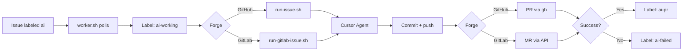

# AI Worker

Server-side automation that watches **GitHub** and **GitLab** issues, runs the Cursor Agent to implement them, and opens pull/merge requests for human review.

Label an issue with `ai` → worker implements it on a branch → opens a PR (GitHub) or MR (GitLab). It never merges automatically.

---

## How to run this app

### One-time setup

```bash
cd /home/ubuntu/ai-worker

# 1) GitHub auth (skip if you only use GitLab)
gh auth login

# 2) GitLab auth (skip if you only use GitHub)
cp .env.example .env
nano .env
# Set:
#   GITLAB_HOST=git.dctm.dev
#   GITLAB_TOKEN=<personal access token with api scope>

# 3) Register local clones (see sections below)
nano projects.conf
nano gitlab-projects.conf

# 4) Create ai / ai-working / ai-pr / ai-failed labels on all registered repos
./setup-labels.sh
```

### Run in the foreground (manual / debug)

```bash
cd /home/ubuntu/ai-worker
./worker.sh
```

- Logs: `logs/worker.log`
- Lock: `state/worker.lock` (only one worker at a time)
- Stop: `Ctrl+C`

### Run a single issue (without the poll loop)

```bash
# GitHub
./run-issue.sh <project-name> <issue-number>

# GitLab
./run-gitlab-issue.sh <project-name> <issue-iid>
```

Examples:

```bash
./run-issue.sh insta2site-api 1
./run-gitlab-issue.sh bale-service 12
```

### Queue work

On any registered repo, open an issue and add the **`ai`** label. Within about 60 seconds the worker should pick it up.

---

## Add as a Linux systemd service

Use this so the worker starts on boot and restarts after failures.

### 1. Install the unit file

A unit file lives in this repo as [`ai-worker.service`](ai-worker.service).

```bash
sudo cp /home/ubuntu/ai-worker/ai-worker.service /etc/systemd/system/ai-worker.service
sudo systemctl daemon-reload
sudo systemctl enable ai-worker
sudo systemctl start ai-worker
```

### 2. Check status and logs

```bash
sudo systemctl status ai-worker
sudo journalctl -u ai-worker -f
tail -f /home/ubuntu/ai-worker/logs/worker.log
```

### 3. Common service commands

```bash
sudo systemctl stop ai-worker
sudo systemctl start ai-worker
sudo systemctl restart ai-worker
sudo systemctl disable ai-worker   # stop starting on boot
```

### 4. After you change scripts or config

```bash
# Config / scripts under /home/ubuntu/ai-worker — restart the service
sudo systemctl restart ai-worker

# Only if you edited /etc/systemd/system/ai-worker.service
sudo systemctl daemon-reload
sudo systemctl restart ai-worker
```

### Unit file contents (reference)

```ini
[Unit]
Description=Cursor AI Issue Worker (GitHub + GitLab)
After=network-online.target
Wants=network-online.target

[Service]
Type=simple
User=ubuntu
Group=ubuntu
WorkingDirectory=/home/ubuntu/ai-worker
Environment=HOME=/home/ubuntu
Environment=PATH=/home/ubuntu/.local/bin:/home/ubuntu/.cursor/bin:/usr/local/sbin:/usr/local/bin:/usr/sbin:/usr/bin:/sbin:/bin
ExecStart=/home/ubuntu/ai-worker/worker.sh
Restart=on-failure
RestartSec=10
KillMode=control-group
TimeoutStopSec=60
UMask=0077
StandardOutput=journal
StandardError=journal

[Install]
WantedBy=multi-user.target
```

Notes:

- `PATH` must include the Cursor CLI (`agent` / `cursor-agent`), usually under `~/.local/bin`.
- The service runs as user `ubuntu` so it can use that user’s `gh` auth, SSH keys, and `.env`.
- Do **not** run `./worker.sh` manually while the systemd unit is active (the lock file will block the second process).

---

## Add a GitHub project

1. Clone the repo locally (if needed):

   ```bash
   git clone git@github.com:ORG/REPO.git /home/ubuntu/dev/my-app
   ```

2. Ensure `origin` points at GitHub and default branch is `main`.

3. Add one line to [`projects.conf`](projects.conf):

   ```conf
   my-app=/home/ubuntu/dev/my-app
   ```

4. Create labels on that repo:

   ```bash
   cd /home/ubuntu/ai-worker
   ./setup-labels.sh
   ```

5. Restart the worker if it is running under systemd:

   ```bash
   sudo systemctl restart ai-worker
   ```

6. On GitHub: open an issue → add label **`ai`**.

Requirements: `gh` authenticated with access to the repo (`gh auth login`, `gh auth status`).

---

## Add a GitLab project

1. Clone from your company GitLab host:

   ```bash
   git clone git@git.dctm.dev:group/subgroup/my-service.git /home/ubuntu/dev/my-service
   ```

2. Ensure `origin` is the GitLab remote and default branch is `main`.

3. Add one line to [`gitlab-projects.conf`](gitlab-projects.conf) (**not** `projects.conf`):

   ```conf
   my-service=/home/ubuntu/dev/my-service
   ```

4. Configure token (once):

   ```bash
   cd /home/ubuntu/ai-worker
   cp -n .env.example .env
   nano .env
   ```

   ```bash
   GITLAB_HOST=git.dctm.dev
   GITLAB_TOKEN=glpat-xxxxxxxx
   ```

   Token needs **`api`** scope (read/write issues, labels, merge requests). Git push still uses your SSH key / git credentials.

5. Create labels:

   ```bash
   ./setup-gitlab-labels.sh
   # or for both forges:
   ./setup-labels.sh
   ```

6. Restart the service:

   ```bash
   sudo systemctl restart ai-worker
   ```

7. On GitLab: open an issue → add label **`ai`**.

Without `GITLAB_TOKEN`, GitHub still works; GitLab projects are skipped with a warning.

---

## How it works



1. **`worker.sh`** polls every 60 seconds.
2. Reads GitHub from `projects.conf`, then GitLab from `gitlab-projects.conf` (one issue per cycle; GitHub first).
3. Label becomes `ai-working`.
4. Runner implements with Cursor, then opens a PR/MR.
5. Success → `ai-pr`. Failure → `ai-failed` (not auto-retried).

## Prerequisites

| Requirement | Notes |
|-------------|-------|
| **Git** | Default branch `main` |
| **GitHub CLI** (`gh`) | For GitHub projects |
| **curl** + **jq** | GitLab REST API |
| **flock** | Single worker process |
| **Cursor CLI** | `agent` or `cursor-agent` on `PATH` |
| **GITLAB_TOKEN** | `api` scope; GitLab only |

## Labels (GitHub and GitLab)

The worker uses the **same four label names** on both GitHub and GitLab. You must create them on every registered repository before queuing issues.

### What each label means

| Label | Color | Who sets it | Meaning |
|-------|-------|-------------|---------|
| `ai` | Green (`0E8A16`) | **You** (manually) | Queue this open issue for the worker |
| `ai-working` | Yellow (`FBCA04`) | Worker | Issue is being processed right now |
| `ai-pr` | Blue (`1D76DB`) | Worker | Finished successfully; a PR (GitHub) or MR (GitLab) was opened |
| `ai-failed` | Red (`D73A4A`) | Worker | Run failed — check logs before retrying |

Only **`ai`** is applied by hand. The worker moves labels through the lifecycle; do not set `ai-working` / `ai-pr` / `ai-failed` yourself unless you are cleaning up a stuck issue.

### Label lifecycle

```
ai  →  ai-working  →  ai-pr      (success — PR/MR created)
                 ↘  ai-failed   (failure — not auto-retried)
```

| Step | Labels |
|------|--------|
| You queue work | Add `ai` on an **open** issue |
| Worker starts | Removes `ai`, adds `ai-working` (also removes `ai-failed` if retrying) |
| Success | Removes `ai-working`, adds `ai-pr` |
| Failure | Removes `ai-working`, adds `ai-failed` |
| Retry after failure | Review logs, then add `ai` again |

Failed issues are **not** re-queued automatically (avoids infinite loops).

### Create labels on all registered repos

From the worker directory, after `projects.conf` / `gitlab-projects.conf` (and `.env` for GitLab) are configured:

```bash
cd /home/ubuntu/ai-worker

# Both GitHub and GitLab (recommended)
./setup-labels.sh
```

What that does:

- **GitHub:** uses `gh label create ... --force` for every path in `projects.conf`
- **GitLab:** calls `./setup-gitlab-labels.sh`, which creates or updates labels via the GitLab API for every path in `gitlab-projects.conf`

### Create labels on GitHub only

Requirements: `gh` installed and authenticated (`gh auth login`).

```bash
cd /home/ubuntu/ai-worker
# Ensure the repo is listed in projects.conf, then:
./setup-labels.sh
```

Or create them manually in the GitHub UI: **Issues → Labels → New label**, using the names and colors in the table above.

### Create labels on GitLab only

Requirements: `.env` with `GITLAB_HOST` and `GITLAB_TOKEN` (`api` scope).

```bash
cd /home/ubuntu/ai-worker
cp -n .env.example .env
# Edit .env and set GITLAB_TOKEN

./setup-gitlab-labels.sh
```

Or create them manually in GitLab: **Project → Manage → Labels → New label**, using the same names and colors.

### How to use labels day to day

1. Open (or create) an issue on a registered GitHub or GitLab project.
2. Add the **`ai`** label only.
3. Wait for the poll cycle (~60s). The label should become **`ai-working`**, then **`ai-pr`** or **`ai-failed`**.
4. On success, review the PR/MR. On failure, inspect `logs/` and add **`ai`** again when ready to retry.

If labels are missing on a repo, the worker cannot find or update the issue — run the setup script again after registering a new project.

## What Cursor does vs. what the scripts do

Cursor implements the issue and leaves **uncommitted** changes. It must not run Git, `gh`, or GitLab API commands.

The runners handle staging, secret checks, commit, push, PR/MR creation, and cleanup back to `main`.

## Safety

- Clean repo required before start
- Blocks staging `.env`, `*.pem`, `*.key`, `id_rsa`, `id_ed25519`
- No auto-merge
- Single worker via file lock
- One issue per polling interval
- Local task branch deleted after push; remote branch kept for the PR/MR

## Directory layout

```
ai-worker/
├── worker.sh               # Poll loop (GitHub + GitLab)
├── run-issue.sh            # GitHub pipeline
├── run-gitlab-issue.sh     # GitLab pipeline
├── setup-labels.sh         # Labels on GitHub + GitLab
├── setup-gitlab-labels.sh  # GitLab labels only
├── ai-worker.service       # systemd unit (copy to /etc/systemd/system/)
├── projects.conf           # GitHub name → local path
├── gitlab-projects.conf    # GitLab name → local path
├── .env.example            # GITLAB_HOST / GITLAB_TOKEN template
├── lib/
│   ├── common.sh
│   └── gitlab.sh
├── logs/
└── state/
```

## Configuration

| Setting | Location | Default |
|---------|----------|---------|
| Poll interval | `worker.sh` → `CHECK_INTERVAL` | 60 seconds |
| Base directory | Scripts → `BASE_DIR` | `/home/ubuntu/ai-worker` |
| GitLab host | `.env` → `GITLAB_HOST` | `git.dctm.dev` |
| GitLab token | `.env` → `GITLAB_TOKEN` | required for GitLab |
| Branch naming | runners | `ai/issue-<number>` |

## Troubleshooting

| Problem | What to check |
|---------|----------------|
| Issue not picked up | Open? Has `ai`? Correct conf file? Service running? |
| GitLab skipped | `.env` has `GITLAB_TOKEN`? Restart service after editing `.env` |
| `ai-failed` | `logs/<project>-*-issue-<n>-*.log` and `*.cursor.ndjson` |
| Worker not starting | `systemctl status ai-worker` or lock `state/worker.lock` |
| `agent: command not found` | PATH in the unit file must include `~/.local/bin` |
| PR/MR not created | `gh auth status` (GitHub) or token scopes / SSH push (GitLab) |

## License

Private infrastructure — adjust as needed for your organization.
